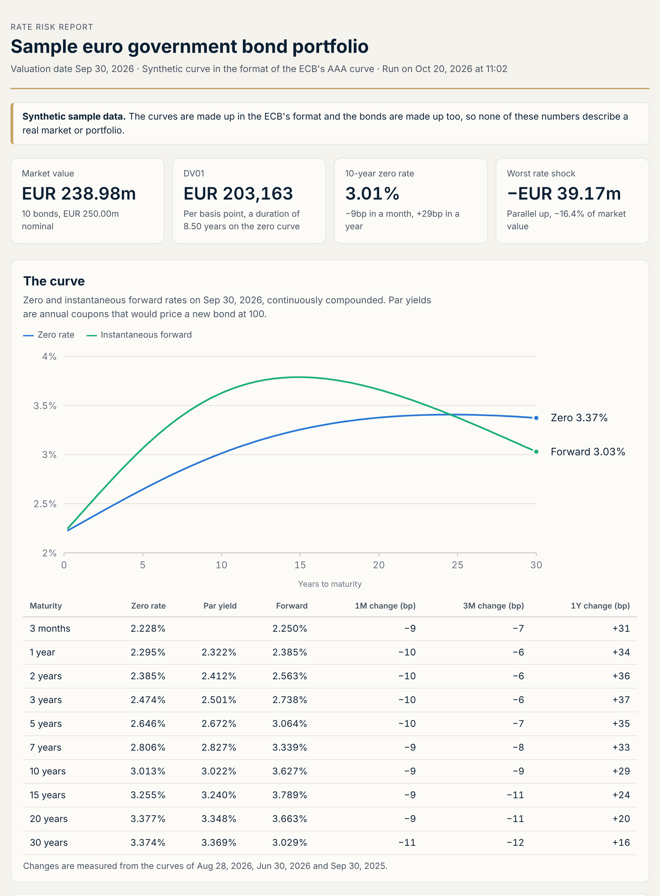
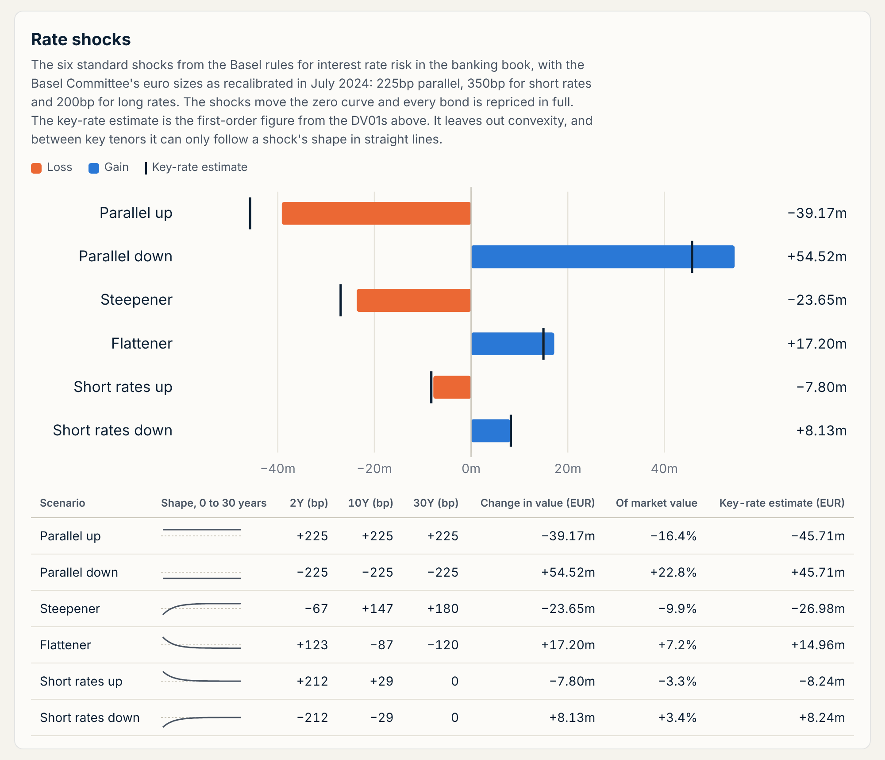

# Euro curve and rate risk

[](https://github.com/sswnair/euro-curve-risk/actions/workflows/tests.yml)

Rebuilds the euro area government yield curve from the six numbers the ECB publishes for it every business day, prices a bond portfolio off that curve, and measures the portfolio's interest rate risk: DV01, key-rate DV01s and the six standard Basel rate shocks.



## What it does

1. Reads a history of daily curves in the ECB's format: the Svensson parameters, and the zero rates the ECB publishes with them. `eurocurve download` fetches both from the ECB.
2. Rebuilds each day's curve from its parameters: zero rates, instantaneous forward rates, discount factors and par yields at any maturity.
3. Checks the rebuilt curve against the published zero rates, and fits a fresh Svensson curve to those rates as a test of the fitting code.
4. Prices each bond off the curve and finds the yield to maturity that gives the same price, along with its Macaulay and modified duration and convexity.
5. Measures DV01 for a parallel move in the zero curve and splits it across nine key tenors.
6. Applies the six standard shocks (parallel up and down, steepener, flattener, short rates up and down), reprices every bond in full, and compares the result with a first-order estimate from the key-rate DV01s.
7. Writes a self-contained HTML report, with CSV files of everything behind it.

## The sample

Ten made-up euro government bonds, EUR 250m nominal, maturing between 2027 and 2056. They include a zero-coupon bond, a 1.25% bond due in 2048 that is priced at about 67, and a 4.75% bond due in 2040 that is priced above 117. The curves are made up too: a year of daily curves in the ECB's format, from September 30, 2025 to September 30, 2026.

On September 30, 2026 the portfolio is worth EUR 238.98m, yields 2.90% on average and has a DV01 of EUR 203,163 per basis point.

| Shock | Change in value | Key-rate estimate |
|---|---|---|
| Parallel up, +225bp | -EUR 39.17m (-16.4%) | -EUR 45.71m |
| Parallel down, -225bp | +EUR 54.52m (+22.8%) | +EUR 45.71m |
| Steepener | -EUR 23.65m (-9.9%) | -EUR 26.98m |
| Flattener | +EUR 17.20m (+7.2%) | +EUR 14.96m |
| Short rates up | -EUR 7.80m (-3.3%) | -EUR 8.24m |
| Short rates down | +EUR 8.13m (+3.4%) | +EUR 8.24m |



A 225bp fall in rates gains EUR 15.36m more than the same rise loses. That is convexity, and the first-order estimate, which comes out the same size both ways, misses it. The steepener loses money even though it lowers short rates, because it only lowers them out to about three years, and over 90% of the portfolio's DV01 sits at five years and beyond.

The curve history has two things for the checks to find: a day in March when the 3-month rate jumps by 20 basis points, and a business day in June with no curve at all.

## Quick start

```bash
git clone https://github.com/sswnair/euro-curve-risk.git
cd euro-curve-risk
python3 -m venv .venv && source .venv/bin/activate
pip install -e ".[dev]"

eurocurve run --sample
```

The run writes the report to `output/`, along with CSV files of the bonds, the key-rate DV01s, the shocks, the curve on the valuation date, the zero rate history and the checks.

To use the ECB's own curve:

```bash
eurocurve download --start 2025-09-30 --end 2026-09-30 --out ecb-curve.csv
eurocurve run --sample --curve ecb-curve.csv
```

The first line downloads the AAA curve (`--rating all` gives the curve for all euro area government bonds). The second prices the sample bonds off it. For your own bonds, lay out a folder like `data/sample` and run `eurocurve run --data path/to/folder`. `--date` values an earlier day, and with `--fail-on-checks` the run exits with code 2 when a check fails.

## Conventions

The Svensson zero rate at maturity t, with f(x) = (1 - exp(-x)) / x, is

```
z(t) = beta0 + beta1 f(t/tau1) + beta2 [f(t/tau1) - exp(-t/tau1)] + beta3 [f(t/tau2) - exp(-t/tau2)]
```

- Zero and forward rates are continuously compounded and in percent, as the ECB publishes them. Time runs actual/365 from the valuation date.
- Bonds pay annual coupons on the maturity date's day and month, accrue on an actual/actual (ICMA) basis and are redeemed at 100. Prices are per 100 nominal, for settlement on the valuation date, and market values include accrued interest.
- Yields are annual, by the ICMA convention: a cash flow k coupon periods after the next coupon date is discounted over w + k years, where w is the part of the current coupon period still to run.
- DV01 is the gain for a 1 basis point fall in every zero rate, from a bump each way. A 1 basis point move in a continuously compounded rate is a (1 + y) basis point move in an annual yield y, so DV01 sits close to Macaulay duration times value / 10,000 rather than modified duration times value / 10,000. With positive yields that makes it a little larger. In the sample the duration on the zero curve is 8.50 years, against a Macaulay duration of 8.53 and a modified duration of 8.28, both weighted by market value.
- Key-rate DV01s come from tent-shaped bumps at 1, 2, 3, 5, 7, 10, 15, 20 and 30 years. The first tent stays flat down to zero and the last stays flat beyond 30 years, so the tents add up to a parallel move and the key-rate DV01s add up to the DV01.
- The shocks are the six standard scenarios from the Basel Committee's rules for interest rate risk in the banking book (BCBS 368, 2016), with the euro sizes from the Committee's July 2024 recalibration: 225bp parallel, 350bp short and 200bp long. The short shock fades with maturity as exp(-t/4) and the long shock builds as 1 - exp(-t/4). To use the 2016 sizes (200, 250 and 100), change `shock_sizes_bp` and `shock_sizes_note` in `settings.json`.

## How it is organized

The package is in `src/eurocurve`:

```
models.py       the small objects passed around: curve parameters, bonds, positions, settings
dates.py        the curve's time axis, moving dates by years and months, the TARGET calendar
ecb.py          downloads the ECB's curve data and reads its CSV format
data.py         reads a data folder: curve history, portfolio, settings
svensson.py     zero rates, forward rates, discount factors and par yields; fitting the curve
curve.py        one day's curve, and shifted copies of it for bumps and shocks
bonds.py        coupon dates, accrued interest, cash flows, prices, yields, duration, convexity
risk.py         DV01 and key-rate DV01s
scenarios.py    the six rate shocks, full revaluation and the key-rate estimate
portfolio.py    the analysis for one valuation date
checks.py       the curve against the published rates, the refit, gaps, big moves, the risk adding up
report.py       the HTML report and CSV outputs
cli.py          the eurocurve command
```

`scripts/make_samples.py` writes the synthetic curves in `data/sample`.

## Limitations

- Every bond is priced off one curve with no spread. A bond that isn't AAA, or that trades rich or cheap to the curve, gets a model price, not its market price.
- Prices are for settlement on the curve date rather than two business days later.
- Coupons are annual, with no odd first or last periods and no ex-coupon period. Coupon dates are not moved for weekends or holidays.
- Shocked rates have no floor, and the shocks are instantaneous: positions don't change and there is no carry or roll-down.
- The ECB fits its curve to bonds with three months to 30 years left to run, so rates outside that range are extrapolated.
- This is a portfolio project, not a production risk system.

## Tests

```bash
pytest
```

225 tests: worked examples for the curve formulas, coupon dates and accrued interest, prices and yields, duration and convexity, the key-rate tents and the shocks; duration and convexity checked against small moves in the yield; the reader for the ECB's file format; and a full run of the sample checked against its expected numbers.

---

Sanjay Nair, CFA · [sswnair.github.io](https://sswnair.github.io)
